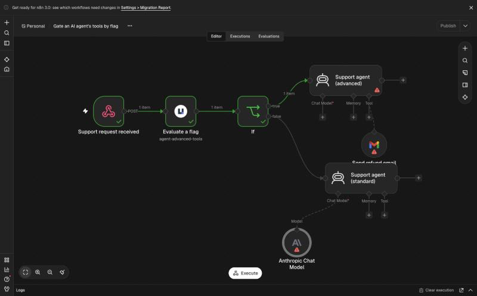
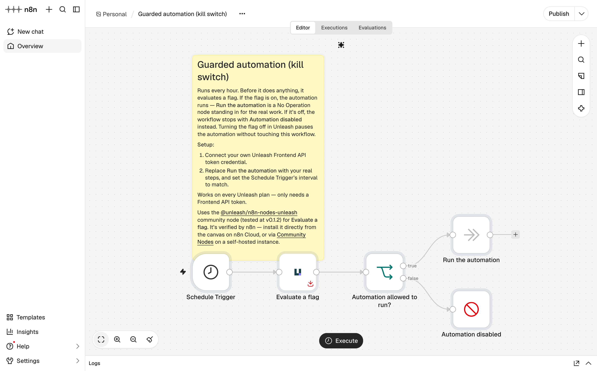
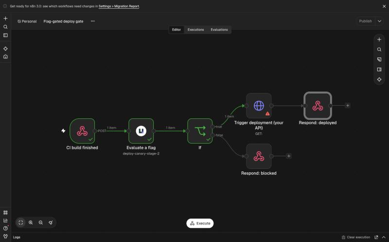
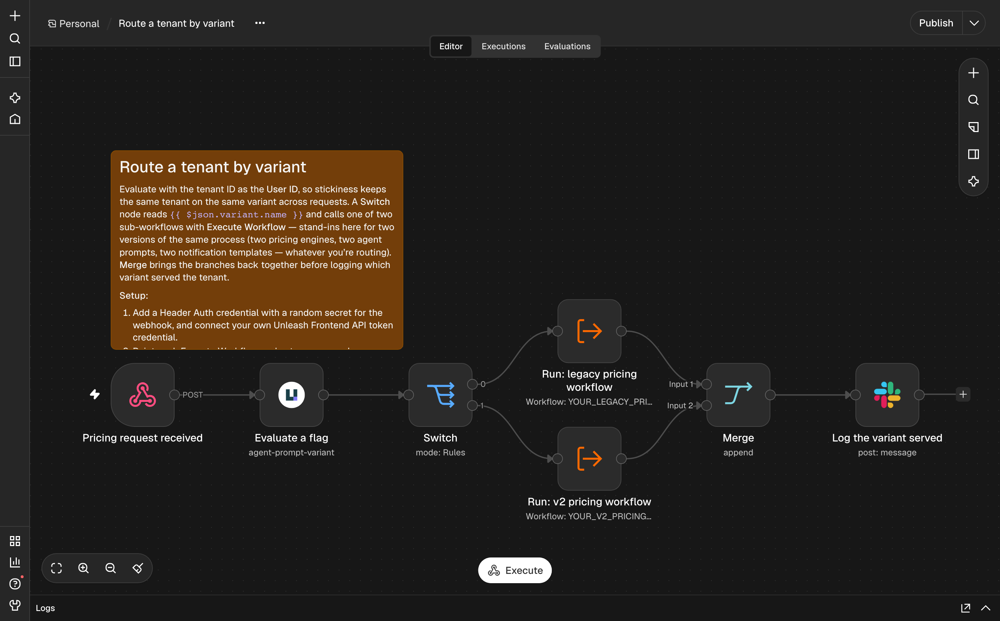

# n8n-nodes-unleash

An [n8n](https://n8n.io) community node for [Unleash](https://www.getunleash.io). Evaluate feature flags in your workflows and AI agents, and react to flag changes.

The node evaluates flags through the Unleash [Frontend API](https://docs.getunleash.io/api/frontend-api-overview) with a frontend token, on every Unleash plan. It works against Unleash itself or against [Unleash Edge](https://docs.getunleash.io/api/edge-api-overview).

- [Installation](#installation)
- [Credentials](#credentials)
- [Operations](#operations)
- [Use it as an AI agent tool](#use-it-as-an-ai-agent-tool)
- [React to flag changes](#react-to-flag-changes)
- [Change flags from n8n](#change-flags-from-n8n)
- [Example workflows](#example-workflows)
- [Compatibility](#compatibility)
- [Development](#development)

## Installation

Follow the n8n guide to [install a community node](https://docs.n8n.io/integrations/community-nodes/installation-and-management/gui-installation) and enter the package name:

```
@unleash/n8n-nodes-unleash
```

## Credentials

The node uses one credential, **Unleash Frontend API**:

| Field          | Value                                                                                                                                             |
| -------------- | ------------------------------------------------------------------------------------------------------------------------------------------------- |
| Base URL       | The Frontend API URL of your Unleash instance or Unleash Edge, ending in `/api/frontend`. For example `https://unleash.example.com/api/frontend`. |
| Frontend Token | A [frontend token](https://docs.getunleash.io/concepts/api-tokens-and-client-keys) for the environment you want to evaluate.                      |

Create the token in Unleash under **Admin settings > Access control > API access**, or under **Settings > API access** inside a project. Choose the **Frontend** type, the projects and the environment.

Frontend tokens are built to be shared with client-side apps: they can only read the flags that are enabled in their projects and environment. To keep evaluation inside your network, point the Base URL at an Unleash Edge instance you host.

## Operations

The node has one resource, **Flag**, with two operations. Both take the same context fields.

### Evaluate

Checks whether one flag is enabled for a context, and returns its variant.

```json
{
	"name": "new-checkout",
	"enabled": true,
	"variant": {
		"name": "blue",
		"enabled": true,
		"feature_enabled": true,
		"payload": { "type": "json", "value": "{\"color\":\"blue\"}" }
	}
}
```

A flag that is disabled, archived, unknown or outside the token's projects returns `enabled: false` with the `disabled` variant. The Frontend API leaves disabled flags out of its response, so the node can't tell these cases apart, and a missing flag is never an error.

Use an **If** or **Switch** node on `{{ $json.enabled }}` or `{{ $json.variant.name }}` to branch. A variant payload is returned as a string; parse a JSON payload with `{{ JSON.parse($json.variant.payload.value) }}`.

**Report Usage** is on by default. Each evaluation then sends one usage metric to Unleash, so flags that are only used in n8n still show as in use, and n8n appears among the connected SDKs (as `n8n-nodes-unleash`). If the metric can't be sent, the node logs a warning and the workflow carries on.

### Get Enabled

Returns one item per flag that is enabled for the context, in the same shape as Evaluate. It does not report usage: counting every returned flag as used would hide flags that are really stale.

When no flag is enabled, the node returns no items and the workflow stops there. Turn on **Always Output Data** in the node settings if the workflow should continue.

### Context fields

| Field                                  | Description                                                                                                   |
| -------------------------------------- | ------------------------------------------------------------------------------------------------------------- |
| User ID                                | The user to evaluate for.                                                                                     |
| Session ID                             | Used for stickiness when there is no user ID.                                                                 |
| Additional Context > App Name          | Sent in the context and in usage metrics. Defaults to `n8n`.                                                  |
| Additional Context > Custom Properties | Name and value pairs for strategy constraints, for example `plan` = `enterprise`. Values are sent as strings. |
| Additional Context > Remote Address    | IP address for IP-based strategies.                                                                           |

Set a **User ID** or **Session ID** whenever a flag uses a gradual rollout. Without either, Unleash makes up a random session ID for each request, so the same input can get a different result on every run. See [stickiness](https://docs.getunleash.io/concepts/stickiness). Without a Remote Address, Unleash uses the IP address of your n8n server. More on the [Unleash context](https://docs.getunleash.io/concepts/unleash-context).

## Use it as an AI agent tool

The node can be attached to an **AI Agent** node as a tool, so an agent can check a flag before it acts. A common pattern is a kill switch for an agent: evaluate a flag at the start of the workflow and stop when it's off.

### Give the agent more tools only when a flag is on



A tool you attach to an AI Agent node is always available to the model; there's no built-in way to show or hide one tool based on a condition. To gate a tool, evaluate a flag first and use an **If** node to route to one of two AI Agent nodes: one wired to only the tools you're comfortable the model always has, the other wired to the same tools plus the one that takes a real action (sending an email, changing a record, calling a paid API). Turning the flag off removes the tool itself, not just a check the model could ignore or route around.

## React to flag changes

Unleash can send flag events to n8n through its Webhook integration and n8n's built-in Webhook node. No extra node is needed.

1. In n8n, add a [Webhook](https://docs.n8n.io/integrations/builtin/core-nodes/n8n-nodes-base.webhook) node. Set **HTTP Method** to `POST`, and **Authentication** to **Header Auth** with a [credential](https://docs.n8n.io/integrations/builtin/credentials/webhook) whose name is `Authorization` and whose value is a long random secret. Copy the production URL and activate the workflow.
2. In Unleash, go to **Integrations**, open **Webhook** and configure it:
   - **Webhook URL**: the production URL from n8n.
   - **Authorization**: the same secret. Unleash sends it as the `Authorization` header exactly as you type it, with no `Bearer` prefix.
   - **Events**: the events you want. Optionally limit them to some projects and environments.
3. In n8n, route on the event type with a [Switch](https://docs.n8n.io/integrations/builtin/core-nodes/n8n-nodes-base.switch) node on `{{ $json.body.type }}`.

Each request carries one event. The fields you'll use most are `id`, `type`, `featureName`, `project`, `environment`, `createdBy` and `createdAt`.

| Event                                          | `type`                                                                                                                                                           |
| ---------------------------------------------- | ---------------------------------------------------------------------------------------------------------------------------------------------------------------- |
| Flag turned on or off in an environment        | `feature-environment-enabled`, `feature-environment-disabled`                                                                                                    |
| Strategy added, changed or removed             | `feature-strategy-add`, `feature-strategy-update`, `feature-strategy-remove`                                                                                     |
| Flag created, archived or marked stale         | `feature-created`, `feature-archived`, `feature-stale-on`                                                                                                        |
| Lifecycle: flag completed or potentially stale | `feature-completed`, `feature-potentially-stale-on`                                                                                                              |
| Change requests (Enterprise)                   | `change-request-sent-to-review`, `change-request-approved`, `change-request-applied`, `change-request-cancelled`, `change-request-scheduled-application-failure` |

Plan for these when you build on webhooks:

- **Order and duplicates.** Events can arrive out of order, and the same event can arrive twice. Use the numeric `id` to order events and to drop duplicates, for example with the [Remove Duplicates](https://docs.n8n.io/integrations/builtin/core-nodes/n8n-nodes-base.removeduplicates) node set to remove items processed in previous executions.
- **No guaranteed retry.** Don't rely on Unleash retrying a failed delivery. Keep the workflow that receives events small and always on.
- **Private URLs.** Unleash rejects webhook URLs that point to a private or internal network address. If you self-host both Unleash and n8n on a private network, set `UNLEASH_ALLOW_PRIVATE_URL_IN_INTEGRATION=true` or list the host in `UNLEASH_ALLOW_LIST_INTEGRATION` on the Unleash server.

See the Unleash [Webhook integration docs](https://docs.getunleash.io/integrate/webhook) for all options.

## Change flags from n8n

This node only reads flags. To change them (turn flags on or off, roll out, kill switches, clean up), connect n8n's built-in [MCP Client](https://docs.n8n.io/integrations/builtin/core-nodes/n8n-nodes-langchain.mcpclient) or [MCP Client Tool](https://docs.n8n.io/integrations/builtin/cluster-nodes/sub-nodes/n8n-nodes-langchain.toolmcp) node to the [Unleash MCP server](https://docs.getunleash.io/integrate/mcp). The remote MCP server is available on Unleash Enterprise. It opens change requests where your environments require them.

## Example workflows

Each pattern below was built and run in n8n. A node you'd still need to configure yourself (an HTTP endpoint, a Slack channel, your own sub-workflows) is left unconfigured in the screenshot, so you can see the shape of the workflow without copying placeholder values out of it.

### Guard a scheduled automation with a kill switch



A Schedule Trigger runs some automation every hour. Before it does anything, it evaluates a flag. If the flag is on, the automation runs — here a **No Operation** node stands in for the real work. If it's off, the workflow stops with **Stop and Error**. Turning the flag off in Unleash pauses the automation without touching the workflow in n8n.

### Gate a deploy on a flag, from CI



A webhook from your CI system triggers the node, with the service name passed in as a custom property under Additional Context. If the flag for that stage is on, the workflow calls your deployment API and responds `deployed`; if it's off, it responds `blocked` without deploying. This turns Unleash into a release gate your pipeline already talks to over HTTP, with no Unleash write access needed anywhere in the pipeline.

### Route a tenant to a different workflow by variant



Evaluate with the tenant ID as the **User ID**, so [stickiness](https://docs.getunleash.io/concepts/stickiness) keeps the same tenant on the same variant across requests. A **Switch** node reads `{{ $json.variant.name }}` and calls one of two sub-workflows with **Execute Workflow** — stand-ins here for two versions of the same process, for example two pricing engines, two system prompts for an AI agent, or two notification templates. **Merge** brings the branches back together before logging which variant served the tenant. Because the Unleash variant drives the routing, you can move a tenant to the new version, or change the rollout percentage, without redeploying the workflow.

### Ready-made templates

The [`/templates`](templates) folder has six full workflows exported as JSON, ready to import: two that work on every plan (an agent kill switch and a lifecycle-driven Jira ticket), and four Enterprise ones that call the Unleash MCP server (an incident kill switch, a weekly cleanup sweep, change request approvals, and a Slack ops agent). See [`templates/README.md`](templates/README.md) for what's tested and what each one needs.

### More patterns

| Pattern                                                                           | Nodes you'd pair it with                                                                              |
| --------------------------------------------------------------------------------- | ----------------------------------------------------------------------------------------------------- |
| Weekly digest of flags that look stale                                            | Schedule Trigger, **Get Enabled**, Filter, Slack or Gmail                                             |
| Audit trail of flag changes (see [React to flag changes](#react-to-flag-changes)) | Webhook, Set, Google Sheets, Airtable or Postgres                                                     |
| On-call alert when a kill switch flips off                                        | The webhook from React to flag changes, Switch, Slack, Microsoft Teams or PagerDuty                   |
| Per-customer entitlement check                                                    | **Evaluate** with User ID set to the customer ID, If, HubSpot or Salesforce to look up the plan first |

## Compatibility

Tested with n8n 2.47.5, Unleash 8.3.1 and Unleash Edge 20.6.4.

## Development

```bash
npm install
npm run dev     # starts n8n at http://localhost:5678 with this node loaded
npm run lint
npm test        # builds, then runs the unit tests in test/
```

Releases are published to npm from GitHub Actions with provenance. See `.github/workflows/publish.yml`.

### Versioning

The package and the node have separate version numbers, and they don't need to match:

- The **package version** (`version` in `package.json`) counts releases on npm. It changes with every release, following [semver](https://semver.org).
- The **node version** (`version` in `nodes/Unleash/Unleash.node.ts`) is saved in every workflow that uses the node. A saved workflow keeps its node version, but runs the code of whichever package version is installed.

When you release:

- For a fix, or for something new that existing workflows don't use (an operation, an optional field), bump only the package version.
- For a change that would make existing workflows behave differently (renaming or removing a parameter, changing the output, changing a default), add a node version with [light versioning](https://docs.n8n.io/connect/create-nodes/build-your-node/reference/versioning): set `version: [1, 1.1]`, show the new behavior only from 1.1 with `@version` in `displayOptions`, set `nodeVersion` in `Unleash.node.json` to the new version, and bump the package's minor version. Declarative nodes like this one can't use full versioning.
- n8n saves only the parameters that differ from their default, so a new default reaches every workflow that never changed the field. Treat it as a breaking change.
- Name the node version in `CHANGELOG.md` whenever it changes.

## Resources

- [n8n community nodes](https://docs.n8n.io/integrations/community-nodes/installation-and-management/gui-installation)
- [Unleash Frontend API](https://docs.getunleash.io/api/frontend-api-overview)
- [Unleash API tokens](https://docs.getunleash.io/concepts/api-tokens-and-client-keys)
- [Feature flag concepts](https://docs.getunleash.io/concepts/feature-flags)

## License

[MIT](LICENSE)
